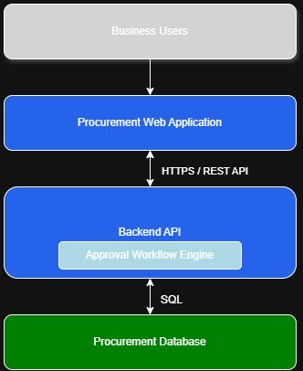
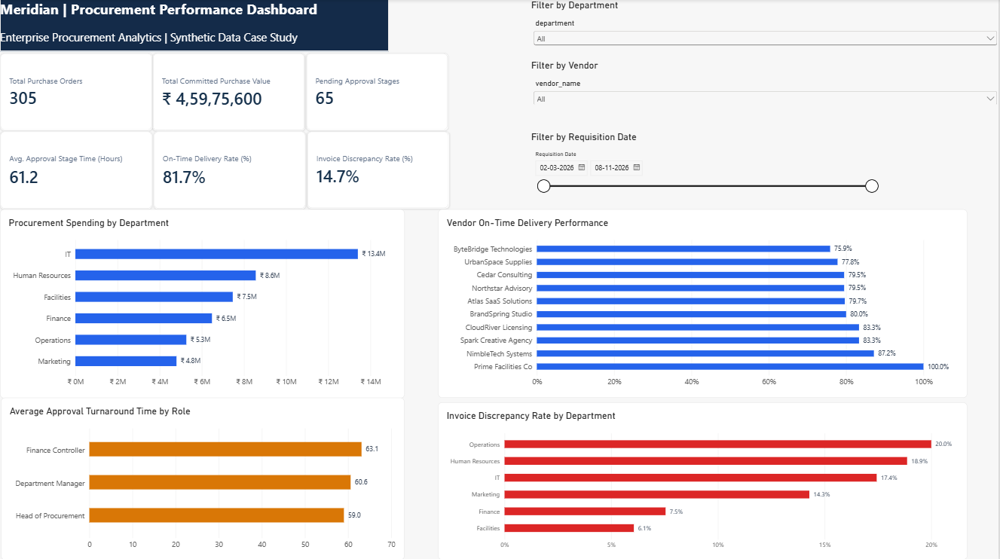

# Enterprise Procurement Process Transformation

**End-to-end Business Analyst and Technical Business Analyst case study**  
**Organisation:** Meridian Global Services *(fictional)*  
**Scope:** Procure-to-pay analysis, requirements engineering, process modelling, SQL, Power BI, API design, Agile delivery and acceptance testing

> **Portfolio case study — synthetic data.** Meridian Global Services, the stakeholders and all transactions are fictional. The findings illustrate analysis of a simulated business process; no real client interviews, enterprise deployment, formally signed-off UAT or achieved business savings are claimed.

## Executive summary

This project examines a simulated enterprise procurement process where purchase requisitions, approvals, vendor delivery tracking and invoice reconciliation require better visibility and control. The case study follows a Technical Business Analyst workflow: define the business problem, capture requirements, model current and future processes, design a database, analyse transaction data, build a management dashboard and validate selected workflows through a working REST API.

**Proposed solution:** A centralised procurement requisition and sequential approval workflow, supported by operational KPIs and exception reporting. The current implementation is a **local FastAPI/SQLite prototype**, not a production ERP system.

## Business problem and objectives

The fictional organisation's starting challenges are treated as **case-study assumptions** rather than verified operational facts:

- Fragmented requisition submissions and approval tracking.
- Limited visibility into approval ageing and purchase order commitments.
- Inconsistent insight into supplier delivery reliability.
- Manual effort identifying invoice discrepancies.

The proposed business outcomes are clearer accountability, faster issue identification, more consistent approval policy enforcement and better management reporting. Improvements are **recommendations and targets**, not measured post-implementation outcomes.

## Technology and BA practices

| Area | Tools / methods |
| --- | --- |
| Business analysis | Project charter, stakeholder analysis, BRD, FRD, AS-IS/TO-BE process modelling |
| Data and modelling | SQLite, relational database design, SQL, Python, ERD |
| Reporting | Power BI Desktop, DAX, seven related CSV source tables |
| API prototype | Python, FastAPI, Pydantic, REST, SQLite |
| Agile and testing | Jira Scrum, epics, user stories, acceptance criteria, functional/API tests, UAT pack, RTM |
| Documentation | Word, Excel, diagrams.net / Draw.io, Markdown |

## Key findings from the synthetic dataset

**Reporting snapshot:** 9 November 2026 at 12:00 UTC. Numbers below come from the original analytics dataset, **not** from subsequent API test submissions.

| Measure | Baseline observation |
| --- | ---: |
| Purchase requisitions | 409 |
| Issued purchase orders | 305 |
| Committed purchase order value | ₹4,59,75,600 |
| Average completed approval-stage time | 61.2 hours |
| Pending approval stages | 65 |
| Pending stages older than illustrative 48-hour threshold | 59 of 65 |
| Delivered purchase orders | 300 |
| On-time deliveries | 245 (81.7%) |
| Invoices with discrepancies | 44 of 300 reviewed (14.7%) |

**Interpretation:** The simulated data highlights approval ageing, late deliveries and invoice mismatches as areas worth investigating. It does **not** establish root causes or demonstrate that the prototype has reduced delays or costs. The “committed value” KPI measures **issued purchase order value**, not actual cash payments.

For methodology and interpretations, see [SQL Results](07_SQL_Business_Analysis/07_SQL_Results.md), [Insights and Actions](07_SQL_Business_Analysis/07_Insights_and_Actions.md), and the [Business Impact Report](12_Business_Impact/12_Business_Impact_and_Recommendations.docx).

## Solution overview

### Process and system design

**Current and proposed procurement workflows**

[AS-IS process](05_Process_Modelling/05_AS_IS_Process.png) · [TO-BE process](05_Process_Modelling/05_TO_BE_Process.png) · [Editable diagrams](05_Process_Modelling/05_Procurement_Process_Models.drawio)

**System architecture (conceptual)**



The conceptual design includes business users, a web application, backend API, approval workflow logic and a procurement database. **The frontend and enterprise integrations are proposed architecture components**, not claims of fully implemented production functionality.

### Implemented API prototype

| Method | Endpoint | Verified behaviour |
| --- | --- | --- |
| `POST` | `/api/requisitions` | Validates and creates a requisition; begins approval routing |
| `GET` | `/api/requisitions/{req_id}` | Returns requisition details and approval history |
| `PATCH` | `/api/requisitions/{req_id}/decision` | Records a stage approval or rejection and advances or finalises the workflow |

**Case-study approval policy:**

- **Up to ₹50,000:** Department Manager.
- **₹50,001–₹2,50,000:** Department Manager, then Finance Controller.
- **Above ₹2,50,000:** Department Manager, Finance Controller, then Head of Procurement.

The API test evidence includes successful two- and three-stage approvals, rejection handling, duplicate/finalised-decision prevention (`409`), role-check failures (`403`), invalid input handling (`422`) and nonexistent requester/vendor checks (`404`, with no records created).

> **Security limitation:** This is a local demonstration API. An `actor_user_id` submitted in the request is checked against a database role, but the caller is **not authenticated**. Production authorisation, audit security, secret management and ERP integration remain out of scope.

### Power BI dashboard



The editable report is available at [Meridian Procurement Analytics (.pbix)](08_PowerBI_Dashboard/Meridian_Procurement_Analytics.pbix). It includes six KPI cards, department spending, vendor delivery performance, approval-stage turnaround, department invoice discrepancy rates, and department/vendor/requisition-date slicers.

The on-time delivery calculation was reconciled against transaction counts: **245 ÷ 300 = 81.7%**. The report uses the CSV files under [`07_SQL_Business_Analysis/powerbi_import/`](07_SQL_Business_Analysis/powerbi_import/). If Power BI cannot refresh on another machine, update the data-source paths to the local cloned folder.

## Repository navigation

| Folder | Deliverables |
| --- | --- |
| [`01_Business_Discovery`](01_Business_Discovery/) | [Project charter](01_Business_Discovery/01_Project_Charter.docx) |
| [`02_Stakeholder_Analysis`](02_Stakeholder_Analysis/) | Stakeholder register and elicitation plan |
| [`03_Business_Requirements`](03_Business_Requirements/) | [BRD](03_Business_Requirements/03_Business_Requirements_Document.docx) |
| [`04_Functional_Requirements`](04_Functional_Requirements/) | [FRD](04_Functional_Requirements/04_Functional_Requirements_Document.docx) |
| [`05_Process_Modelling`](05_Process_Modelling/) | AS-IS/TO-BE diagrams, editable Draw.io source |
| [`06_Database_Design`](06_Database_Design/) | [ERD](06_Database_Design/06_Procurement_ERD.png), schema, sample data, build script |
| [`07_SQL_Business_Analysis`](07_SQL_Business_Analysis/) | SQL investigations, repeatable data generator, results, seven CSVs |
| [`08_PowerBI_Dashboard`](08_PowerBI_Dashboard/) | Editable Power BI report (`.pbix`) |
| [`09_System_Design`](09_System_Design/) | Architecture, [API documentation](09_System_Design/09_API_Specification_and_Validation_Report.docx), source code and test scripts |
| [`10_UAT_and_Testing`](10_UAT_and_Testing/) | [UAT test pack](10_UAT_and_Testing/10_UAT_Test_Cases_and_Execution_Log.docx) |
| [`11_Requirements_Traceability`](11_Requirements_Traceability/) | [Requirements Traceability Matrix](11_Requirements_Traceability/11_Requirements_Traceability_Matrix.xlsx) |
| [`12_Business_Impact`](12_Business_Impact/) | Recommendations, proposed targets and measurement plan |

## Reproduce the analysis locally

**Requirements:** Python 3.10+; Power BI Desktop is needed only to open the `.pbix` report. SQLite support is included in Python.

From a PowerShell terminal opened at the repository root:

```powershell
# 1. Rebuild the small seed database (ignored by Git)
python 06_Database_Design/06_build_and_check.py

# 2. Provide the seed where the analytics builder expects it
Copy-Item 06_Database_Design/06_meridian_demo.db 07_SQL_Business_Analysis/reference/06_meridian_demo.db

# 3. Rebuild the analysis database and refresh SQL/CSV outputs
python 07_SQL_Business_Analysis/07_build_analysis_db.py
python 07_SQL_Business_Analysis/07_run_analysis.py
python 07_SQL_Business_Analysis/07_validate_dataset.py
```

**Note:** `.db` files are intentionally excluded via `.gitignore`, so these commands generate the databases locally. The seven CSV exports are included in the repository for inspection and Power BI use.

### Run the prototype REST API

```powershell
python -m pip install fastapi uvicorn
Copy-Item 07_SQL_Business_Analysis/07_meridian_analysis.db 09_System_Design/api/meridian_api.db
Set-Location 09_System_Design/api
python -m uvicorn main:app --reload
```

Then visit **http://127.0.0.1:8000/docs** for the local interactive Swagger documentation. An example payload is provided at [`09_System_Design/api/example_request.json`](09_System_Design/api/example_request.json); set `needed_by` to a future date before submitting it.

**Important:** Run the API against the copied `meridian_api.db` rather than the original reporting database. API test records should not change the fixed SQL and Power BI baseline.

## Traceability and testing

The project links the business requirements and functional requirements to Jira stories, implementation and test cases. For example:

**BR-03 (approval management)** → **FR-04 (approval routing)** → **Jira SCRUM-6** → **FastAPI routing logic** → **boundary and three-stage workflow tests**.

See the [Requirements Traceability Matrix](11_Requirements_Traceability/11_Requirements_Traceability_Matrix.xlsx) and [UAT Test Pack](10_UAT_and_Testing/10_UAT_Test_Cases_and_Execution_Log.docx). Jira was used to organise and document case-study development work. Formal business-user UAT and sign-off have **not** occurred.

## Recommendations and limitations

Prioritised recommendations include approval ageing and escalation visibility, vendor reliability monitoring, and more structured invoice exception handling. Proposed performance targets in the [Business Impact Report](12_Business_Impact/12_Business_Impact_and_Recommendations.docx) are **illustrative future targets**, not measured improvements.

This MVP uses one purchase order per requisition, at most one receipt and one invoice per order, one currency (INR), and a static synthetic reporting snapshot. It does not include production authentication, a deployed web frontend, a live ERP connection, automated alerts, real financial payments or validated post-implementation ROI.

---

**Purpose:** Demonstrate practical BA and technical BA delivery from business discovery to requirements, data analysis, system design, prototype verification and traceability using a transparent fictional case study.
